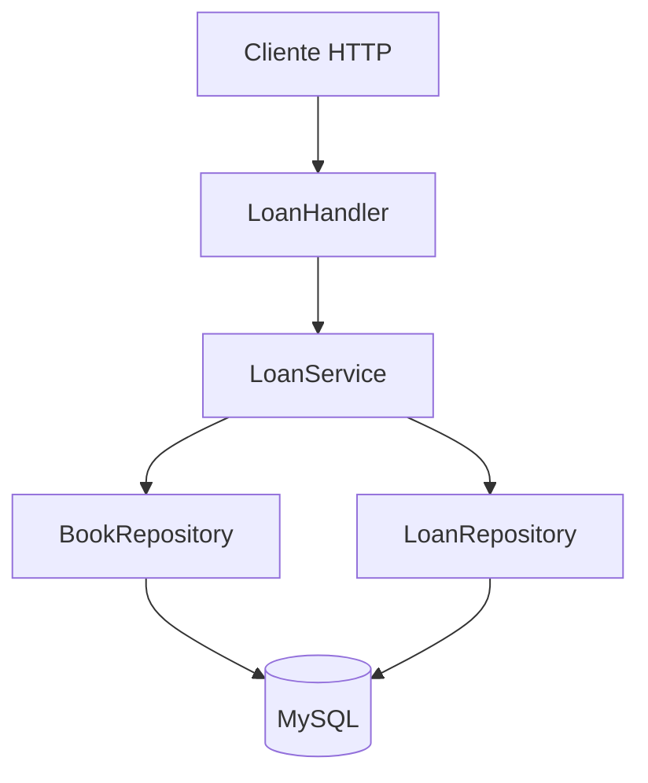

# Fase 1 — Análisis arquitectónico

*Proyecto final · Préstamos de laptops en biblioteca-api*

## 1. Contextualización

El sistema biblioteca-api permite gestionar el catálogo de libros, los usuarios y los préstamos de una biblioteca.

El nuevo requerimiento consiste en incorporar una funcionalidad que permita gestionar el catálogo y los préstamos de laptops, manteniendo el funcionamiento del módulo existente de préstamos de libros.

## 2. Mapa del código existente

La aplicación está organizada mediante una arquitectura por capas.

| Capa | Ubicación | Responsabilidad |
|---|---|---|
| Handler | internal/handler | Recibir solicitudes HTTP y generar respuestas |
| Service | internal/service | Gestionar las reglas de negocio |
| Repository | internal/repository | Gestionar el acceso a la base de datos |
| Models | internal/models | Representar las entidades del sistema |
| Migraciones | migrations | Definir la estructura de la base de datos |

## 3. Flujo actual de préstamos

El módulo existente permite solicitar préstamos de libros mediante la comunicación entre las diferentes capas de la aplicación.

El servicio verifica la existencia del libro, su disponibilidad y la existencia de préstamos duplicados. Posteriormente registra el préstamo y actualiza el inventario.

## 4. Identificación de acoplamientos

El análisis del sistema permite identificar dependencias específicas entre el módulo de préstamos y la entidad Book.

| Componente | Acoplamiento identificado |
|---|---|
| Modelos | Uso de BookID y book_id |
| Base de datos | Relación directa con la tabla books |
| Repositorios | Consultas SQL específicas para libros |
| Servicios | Dependencia de BookRepository |
| Handlers | Solicitudes y respuestas orientadas a libros |
| Reglas de negocio | Validación mediante AvailableCopies |

Estos acoplamientos dificultan la incorporación de nuevos tipos de recursos sin modificar componentes existentes.

## 5. Alternativas arquitectónicas

### Alternativa 1 — Módulo independiente de laptops

Consiste en crear nuevas tablas, modelos, repositorios, servicios y handlers específicos para la gestión de laptops.

Ventajas:

- Bajo impacto sobre el sistema existente.
- Menor riesgo de regresiones.
- Separación de responsabilidades.
- Facilidad de implementación y pruebas.

Desventajas:

- Duplicación parcial de lógica.
- Menor reutilización de componentes.

### Alternativa 2 — Generalización del módulo de préstamos

Consiste en crear una entidad genérica de recursos que permita gestionar libros, laptops y otros elementos mediante un único módulo de préstamos.

Ventajas:

- Mayor reutilización de código.
- Mayor extensibilidad.
- Centralización de las reglas de negocio.

Desventajas:

- Requiere modificar componentes existentes.
- Mayor complejidad de implementación.
- Mayor riesgo de regresiones.

### Alternativa 3 — Tabla única con tipo de recurso

Consiste en adaptar la estructura de préstamos existente mediante un campo que identifique el tipo de recurso prestado.

Ventajas:

- Centralización de los registros.
- Reutilización parcial de la estructura existente.

Desventajas:

- Mayor complejidad en las validaciones.
- Modificación del esquema existente.
- Dificultades para mantener la integridad referencial.

## 6. Tabla de trade-offs

| Criterio | Módulo independiente | Generalización | Tabla única |
|---|---|---|---|
| Complejidad de implementación | Baja | Alta | Media |
| Riesgo de regresiones | Bajo | Alto | Medio |
| Reutilización de código | Baja | Alta | Media |
| Extensibilidad | Media | Alta | Media |
| Impacto sobre el sistema existente | Bajo | Alto | Medio |
| Facilidad de pruebas | Alta | Media | Media |
| Esfuerzo de desarrollo | Bajo | Alto | Medio |

## 7. Alternativa seleccionada

Se selecciona la alternativa 1: implementación de un módulo independiente para la gestión y préstamo de laptops.

Esta decisión permite incorporar la nueva funcionalidad conservando la arquitectura por capas y minimizando las modificaciones sobre el módulo existente de préstamos de libros.

Se prioriza la estabilidad del sistema y la reducción del riesgo de regresiones sobre la reutilización máxima de código.

La decisión arquitectónica se documenta formalmente en el [ADR-001](adr.md).
