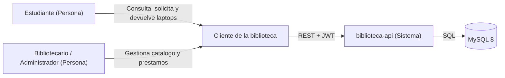
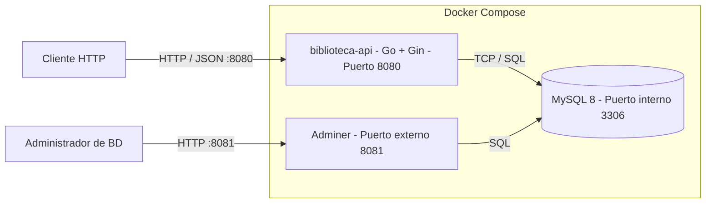
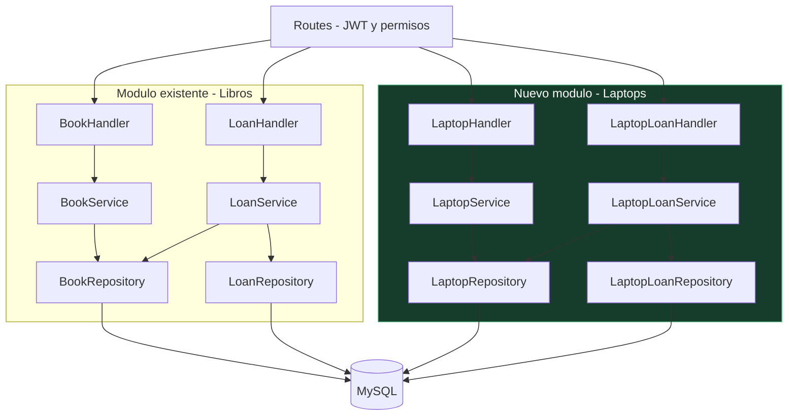
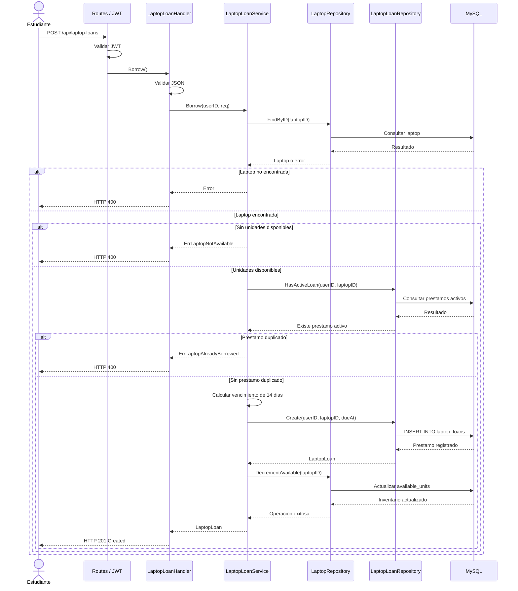
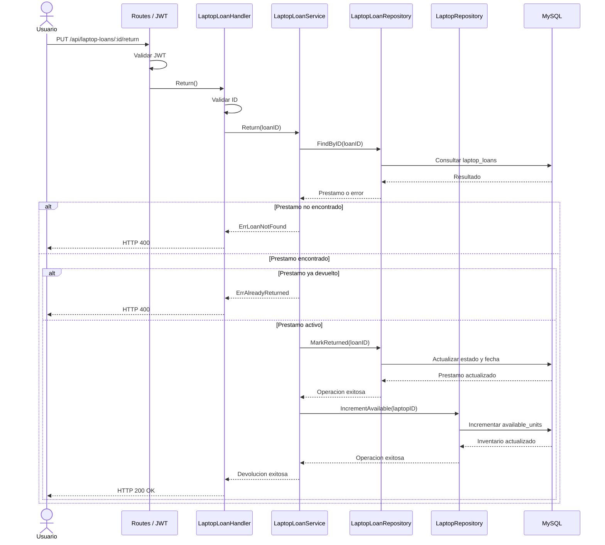

# Fase 5 — Diagramas

*Proyecto final · Feature: **Préstamos de laptops** en `biblioteca-api`*

> Este documento presenta los diagramas correspondientes a la Fase 5 del proyecto, elaborados en Mermaid y coherentes con la decisión arquitectónica ADR-001: implementación de un módulo independiente para la gestión y préstamo de laptops, sin afectar el módulo existente de préstamos de libros.

---

## 1. C4 Nivel 1 — Contexto

**Pregunta:** ¿Quiénes interactúan con el sistema y qué esperan de él?

**¿Qué muestra?** Representa la interacción de los estudiantes y administradores con el sistema. Los estudiantes pueden consultar el catálogo, solicitar préstamos y devolver laptops, mientras que los administradores pueden registrar equipos y consultar los préstamos realizados. La comunicación se realiza mediante solicitudes REST protegidas por JWT y los datos se almacenan en MySQL.

---

## 2. C4 Nivel 2 — Contenedores

**Pregunta:** ¿De qué bloques ejecutables está compuesto el sistema?

**¿Qué muestra?** Los contenedores que conforman la aplicación: la API desarrollada en Go con Gin, MySQL como sistema gestor de base de datos y Adminer como herramienta de administración. La nueva funcionalidad de préstamos de laptops no requiere contenedores adicionales, ya que se incorpora dentro de la API y utiliza la base de datos existente.

MySQL utiliza el puerto interno 3306 y el puerto externo 3307, configurado para evitar conflictos con el servicio local de MySQL.

---

## 3. Diagrama de componentes

**Pregunta:** ¿Qué módulos internos tiene la API y dónde se encuentra la nueva funcionalidad?

**¿Qué muestra?** La organización interna de la API mediante las capas Handler, Service y Repository. El módulo de laptops funciona de manera paralela e independiente al módulo de libros.

Los nuevos componentes reutilizan los mecanismos de autenticación, autorización y conexión a la base de datos existentes, sin establecer dependencias directas con el módulo de préstamos de libros.

Esta estructura respeta la decisión arquitectónica ADR-001 y reduce el riesgo de regresiones.

---

## 4. Diagrama de secuencia — Solicitar préstamo de una laptop

**Pregunta:** ¿Qué ocurre, en orden, cuando un estudiante solicita el préstamo de una laptop?

**¿Qué muestra?** El flujo de comunicación entre los componentes del sistema durante la solicitud de un préstamo de laptop.

El servicio valida la existencia del equipo, verifica que existan unidades disponibles y comprueba que el usuario no tenga un préstamo activo de la misma laptop.

Si las validaciones son exitosas, se registra el préstamo con una duración de 14 días y se disminuye la cantidad de unidades disponibles en el inventario.

Las estructuras alt representan las condiciones y validaciones de negocio implementadas en LaptopLoanService.

---

## 5. Diagrama de secuencia — Devolución de una laptop

**Pregunta:** ¿Cómo se registra la devolución de una laptop y se actualiza su disponibilidad?

**¿Qué muestra?** El proceso de devolución de una laptop, incluyendo la validación de la existencia del préstamo y la comprobación de que no haya sido devuelto anteriormente.

Una vez superadas las validaciones, el sistema actualiza el estado del préstamo, registra la fecha de devolución e incrementa la disponibilidad de la laptop.

Este proceso se realiza exclusivamente dentro del módulo de laptops, sin modificar ni utilizar los servicios de préstamos de libros.

**Hook de integración:** No requerido. La independencia entre ambos módulos permite conservar el funcionamiento del sistema existente, respetando la decisión arquitectónica ADR-001.

---

